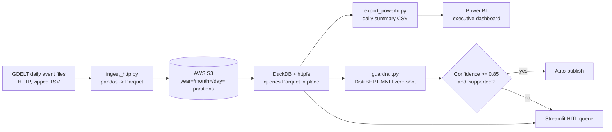
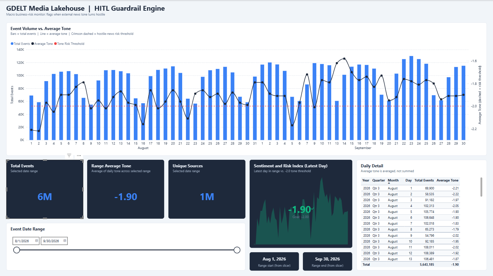
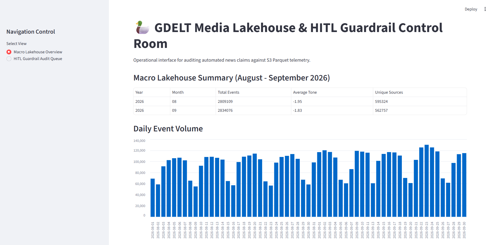
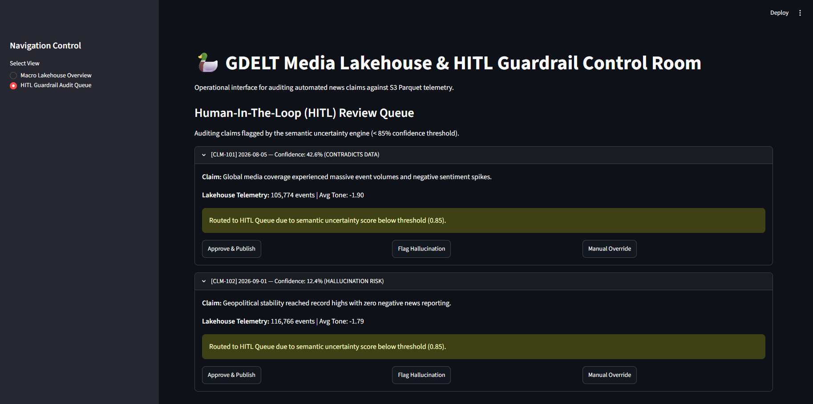

# GDELT Media Lakehouse & HITL Guardrail Engine

A small analytics-engineering project that answers one communications-analytics question: **when is external news turning hostile, and can we trust an automated claim about it before it reaches leadership?**

It ingests global news-event data into an S3 Parquet lakehouse, queries it in place with DuckDB, scores written claims against that data with a transformer, and routes anything the model is unsure about to a human review queue. Results are surfaced in a Streamlit control room (operators) and a Power BI dashboard (executives).

**Stack:** Python · AWS S3 (Parquet) · DuckDB · Hugging Face Transformers · Streamlit · Power BI

---

## Business questions

| Question | Answered by |
|---|---|
| Is external news tone getting more hostile, and on which days? | Power BI: daily average tone vs. a -2.0 risk threshold |
| Is a spike in coverage volume also a spike in negativity? | Power BI: event volume (bars) overlaid with tone (line) |
| Can an automated summary be published without a human check? | Guardrail engine: claim vs. lakehouse telemetry, with confidence routing |
| Who reviews the claims the model isn't sure about? | Streamlit HITL audit queue |

## Architecture



Design choice: no warehouse. DuckDB reads Hive-partitioned Parquet straight from S3, so the whole stack runs on a laptop and costs only S3 storage.

## What the data shows (Aug 1 - Sep 30, 2026)

59 daily partitions, about 5.6M events.

- **10 of 59 days (17%)** fell below the -2.0 tone threshold. Worst day: Aug 2 (-2.22). Best day: Sep 14 (-1.58).
- **Weekends drive the alerts.** Weekends are 29% of days but 6 of the 10 breaches. Weekend volume averages about 63K events/day vs. about 109K on weekdays, with tone about 0.10 points more negative.
- **Tone improved month over month.** August averaged -1.96 with 8 breaches; September averaged -1.83 with 2.
- **Volume and tone are loosely related** (correlation about 0.39 across 59 days): heavier-coverage days tend to be less negative.

**Implication for alerting:** low-volume days produce noisier averages, so some weekend "hostile news" alerts are likely sampling noise rather than real sentiment shifts. A production version should scale the threshold by event volume. With only 59 daily points this is a lead to test, not a proven effect.

## How the guardrail works

1. For a claim and target date, DuckDB pulls that day's event count and average tone from the lakehouse.
2. That telemetry is written into a one-sentence context ("On 2026-08-05, GDELT recorded 105,774 events with average tone -1.9").
3. A zero-shot NLI classifier scores the claim against three labels: *supported by data*, *contradicts data*, *unsupported hallucination*.
4. The claim auto-publishes only if the top label is *supported* **and** its score is at least 0.85. Everything else goes to the human queue.

### Why human review (the research angle)

This design was inspired by [*How Do Uncertainty Estimators Align with Hallucination Occurrence in LLMs?*](https://arxiv.org/abs/2605.27016) (Agnimo et al., 2026). The paper evaluates 46 uncertainty estimators across four benchmarks and finds that the link between model uncertainty and hallucination is often weak and depends on the model and setting. It separates *intrinsic* hallucinations (unsupported by provided context) from *extrinsic* ones (unsupported by model knowledge).

What I took from it:

- **My task is intrinsic.** The claim is checked against context I supply (lakehouse telemetry), which is the setting where grounding is testable.
- **Confidence is not truth.** Because uncertainty is an imperfect hallucination signal, the system never treats a high score as proof. It treats a low score as a reason to involve a person.

What this project does *not* do: it does not implement semantic entropy or any estimator from the paper. It uses a plain softmax confidence from an NLI classifier. The paper is the motivation for the human-in-the-loop design, not the method.

## Model choice and trade-offs

I use `typeform/distilbert-base-uncased-mnli` rather than a larger NLI model such as `bart-large-mnli`.

| | DistilBERT-MNLI (used) | Larger NLI model (e.g. BART-large) |
|---|---|---|
| Size | about 250 MB | about 1.6 GB |
| Memory / latency | Runs on CPU on a laptop | Hit Windows memory-allocation errors on my machine |
| Accuracy / calibration | Lower; scores are less trustworthy | Typically better |
| Fit for this project | Good: the 0.85 threshold plus human review absorbs weaker accuracy | Better judgments, but heavier to run and demo |

The trade-off is explicit: I gave up some model quality for a pipeline anyone can run locally, and I compensated with a conservative threshold and a review queue. The cost is more claims reaching humans.

**Observed behavior:** on the two sample claims, the engine routed both to review. For Aug 5 ("massive event volumes and negative sentiment spikes") it scored *contradicts data* at 0.43, which is defensible because that day's tone (-1.90) was at the period average, so "spikes" overstates it. That is the calibration problem in miniature, and why the queue exists.

## Run it

```bash
pip install duckdb streamlit python-dotenv boto3 pandas pyarrow requests transformers torch

# Copy .env.example to .env in the project root and add your AWS keys and bucket name
# (never commit .env)

python src/ingest_http.py        # download GDELT, convert to Parquet, upload to S3
python src/export_powerbi.py     # daily summary CSV for Power BI (writes data/)
python src/run_pipeline.py       # guardrail evaluation + refresh export
streamlit run src/app.py         # control room
```

## Repo layout

```
src/
  app.py             Streamlit control room (lakehouse overview + HITL queue)
  ingest_http.py     GDELT -> Parquet -> S3, partitioned by year/month/day
  database.py        DuckDB connection + daily/monthly reports
  guardrail.py       Claim-vs-telemetry scoring and routing
  export_powerbi.py  Daily summary export for the executive dashboard
  run_pipeline.py    End-to-end runner
docs/
  power bi_dashboard.png
  streamlit_overview.png
  streamlit_hitl.png                
data/                Local outputs (gitignored)
.env.example         Template for AWS credentials
requirements/
  base.txt
```

Run all commands from the project root so `data/` and `.env` resolve correctly.

## Screenshots

### Power BI executive dashboard
Volume vs. average tone with a dashed -2.0 risk threshold, KPI cards, and a latest-day risk index that turns crimson below the threshold.



### Streamlit control room


### Human-in-the-loop review queue
Claims below the 0.85 confidence threshold are routed here. The queue items are demo claims.



## Known limitations and next steps

- **The HITL queue is a demo.** Queue items in `app.py` are hard-coded and the Approve / Flag / Override buttons don't persist a decision. Next step: write reviewer decisions to a DuckDB or Parquet table and track reviewer-vs-model agreement.
- **Zero-shot, not fine-tuned.** The classifier is used as-is. Next step: label reviewer outcomes and measure precision/recall and calibration of the 0.85 threshold.
- **Power BI reads a CSV export,** so it is a scheduled refresh, not real-time.
- **Tone is source-reported** (GDELT average tone per event), not a measure of brand or audience sentiment.
- **Single source** (GDELT events). Extending to Share of Voice would need a brand-tagged source.
- **Unweighted tone average.** Range averages average the daily averages. An event-weighted measure is a small DAX change; on this data the difference is about 0.01.
